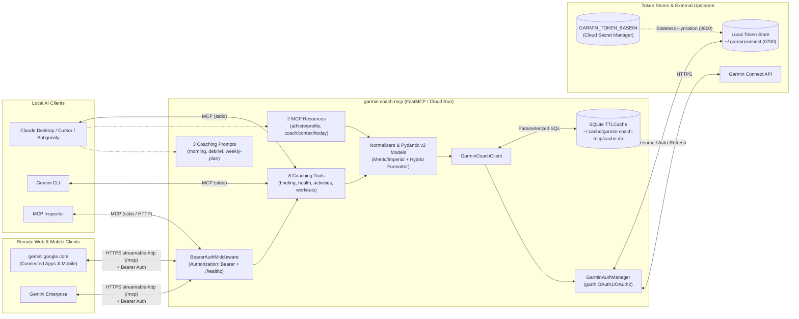

# Garmin Coach MCP Server (`garmin-coach-mcp`)

An elite **Personal Health, Running, and Fitness Coach** [Model Context Protocol (MCP)](https://modelcontextprotocol.io) server powered by Garmin Connect telemetry. Built on the official Python `mcp` SDK (`FastMCP`), `garminconnect`, `garth`, and `Pydantic v2`, this server transforms noisy, deeply nested Garmin Connect API responses into **token-efficient, coach-ready Markdown and structured JSON** for both **local AI clients** (`stdio` for Claude Desktop, Cursor, Antigravity, and Gemini CLI) and **remote web/cloud clients** (`streamable-http` over HTTPS with Bearer token authentication for `gemini.google.com` Connected Apps, Gemini Mobile, and Gemini Enterprise on Google Cloud Run).

---

## Core Coaching Use Cases

1. **Daily Readiness & Morning Check-in**
   - Combines **Training Readiness**, **Body Battery** (current, charged, drained), **Overnight HRV** (last night average, 5-min high, 7-day average vs. baseline), **Sleep stages & score**, **Resting Heart Rate (RHR)**, **Stress**, and **yesterday's training load** in a single aggregated call (`get_coach_daily_briefing`) to answer: *"Should I execute my hard interval session today, modify the pace, or swap for a recovery jog?"*
2. **Deep Workout Analysis & Post-Activity Debrief**
   - Inspects lap/split pacing evenness, Heart Rate Zone distribution, Power/Pace Zone compliance, elevation-adjusted effort, cadence, weather impact, and **cardiac drift (%)** (`get_activity_details`, `list_recent_activities`) to evaluate execution quality.
3. **Longitudinal Trend & Load Management**
   - Tracks **Acute-to-Chronic Workload Ratio (ACWR)**, aerobic/anaerobic load focus, VO2 Max, Endurance/Hill scores (`get_training_status_and_load`), and 7-to-90 day rolling averages & first-half vs. second-half deltas for RHR, HRV, sleep, steps, stress, and training volume (`get_health_trends`) to detect overreaching early.
4. **Adaptive Training Plans & Structured Workout Prescription**
   - Synthesizes athlete biometrics, Lactate Threshold HR/Pace, FTP, and zone boundaries (`get_body_composition_and_biometrics`, `garmin://athlete/profile`) with current recovery state to build periodized training plans and generate **Garmin-compatible structured workouts** (`create_structured_workout_json`) with optional direct upload to Garmin Connect Calendar.

---

## System Architecture



---

## Installation & Setup

### Prerequisites
- **Python 3.11+**
- **[`uv`](https://docs.astral.sh/uv/)** (recommended) or standard `python3 -m venv` + `pip`
- A **Garmin Connect** account

### Option A: One-Click Install (`./install.sh` or `.\install.ps1`) — Recommended

Run the interactive one-click installer from the repository root:

**Linux / macOS / WSL (Bash):**
```bash
cd /path/to/GarminMCP
./install.sh
```

**Windows (PowerShell 5.1+ / PowerShell 7+):**
```powershell
cd C:\path\to\GarminMCP
.\install.ps1
```

Both `./install.sh` and `.\install.ps1` automate the complete 5-stage setup workflow:
1. **`[1/5]` System Requirements Check**: Verifies Python `>= 3.11` (via `python3`/`python`/`py -3` or `uv`).
2. **`[2/5]` Virtual Environment & Dependencies**: Creates `.venv` and installs `garmin-coach-mcp` in editable mode with dev/test dependencies (`uv pip install -e ".[dev]"` or `.venv/bin/pip` / `.venv\Scripts\pip.exe install -e ".[dev]"`), then verifies `garmin-coach-mcp --help`.
3. **`[3/5]` Interactive Garmin Connect Login (MFA/2FA)**: Runs `garmin-coach-mcp auth` (or prompts whether to reuse existing tokens if already present in `~/.garminconnect`).
4. **`[4/5]` OAuth Token & Permission Verification**: Confirms non-empty OAuth token files exist in your token directory (with strict `0700` directory / `0600` file permissions on POSIX systems).
5. **`[5/5]` Optional Live Account Verification & MCP Config Output**: Optionally runs `garmin-coach-mcp verify` to fetch your Garmin athlete profile and prints ready-to-copy MCP registration snippets for **Claude Desktop / Cursor / Antigravity** (`~/.gemini/config/mcp_config.json`) and **Gemini CLI** (`gemini mcp add garmin-coach ...`) using your machine's resolved paths.

#### Installer CLI Flags

| Bash (`./install.sh`) | PowerShell (`.\install.ps1`) | Description |
| :--- | :--- | :--- |
| `--token-dir <dir>` | `-TokenDir <dir>` | Custom directory for Garmin OAuth tokens (defaults to `GARMIN_TOKEN_DIR` or `~/.garminconnect`). |
| `-y`, `--yes` | `-Yes`, `-y` | Run non-interactively without `[Y/n]` confirmation prompts (keeps existing tokens and runs live verification automatically). |
| `--skip-verify` | `-SkipVerify` | Skip the live Garmin athlete profile read check in Step 5. |
| `--skip-auth` | `-SkipAuth` | Skip interactive Garmin login and token checks (Steps 3–5) — ideal for CI or automated testing. |
| `-h`, `--help` | `-Help`, `-h` | Show usage and available flags. |

---

### Option B: Manual Installation (`uv` or `pip`)

**Linux / macOS / WSL:**
```bash
cd /path/to/GarminMCP

# Using uv (recommended):
uv venv
uv pip install -e ".[dev]"

# Or using standard Python venv + pip:
python3 -m venv .venv
.venv/bin/pip install --upgrade pip
.venv/bin/pip install -e ".[dev]"
```

**Windows (PowerShell):**
```powershell
cd C:\path\to\GarminMCP

# Using uv (recommended):
uv venv
uv pip install -e ".[dev]"

# Or using standard Python venv + pip:
python -m venv .venv
.\.venv\Scripts\Activate.ps1
.\.venv\Scripts\pip.exe install --upgrade pip
.\.venv\Scripts\pip.exe install -e ".[dev]"
```

Verify the CLI entrypoint is installed and responsive:

```bash
# Cross-platform via uv:
uv run garmin-coach-mcp --help

# Or directly via virtualenv binary (Linux / macOS / WSL):
.venv/bin/garmin-coach-mcp --help

# Or directly via virtualenv binary (Windows PowerShell):
.\.venv\Scripts\garmin-coach-mcp.exe --help
```

---

## Authentication & MFA / 2FA Bootstrap Guide

Garmin Connect uses `garth` (OAuth1 + OAuth2) and frequently challenges logins with **2FA / MFA** or Cloudflare protections. Because MCP servers run headlessly over `stdio`, interactive MFA prompts during an active agent tool call would hang stdio transport.

`garmin-coach-mcp` solves this with a **two-stage authentication lifecycle**:

### Step 1: One-Time Interactive Token Bootstrap (Recommended for All Users & MFA Accounts)

Run the built-in interactive authentication command once in your terminal:

```bash
uv run garmin-coach-mcp auth
```

Or specify a custom email and token directory:

```bash
uv run garmin-coach-mcp auth --email your-email@example.com --token-dir ~/.garminconnect
```

1. You will be prompted for your Garmin Connect email and password (hidden input) if not already set in the environment.
2. If your account has **2FA / MFA** enabled, you will be prompted interactively in your terminal for the one-time verification code sent via SMS or email.
3. Upon success, `garth` saves `oauth1_token.json` and `oauth2_token.json` to `~/.garminconnect` (with `0700` directory permissions).
4. During all future headless MCP server runs, `GarminAuthManager` automatically resumes from `~/.garminconnect` and refreshes short-lived OAuth2 tokens using the long-lived OAuth1 token (~1 year validity) **without storing your raw password or re-prompting for MFA**.

### Step 2: Verify Saved OAuth Tokens & Account Access (`garmin-coach-mcp verify`)

After authenticating, verify your saved tokens and perform a live read check of your Garmin athlete profile:

```bash
uv run garmin-coach-mcp verify
# or with a custom token directory:
uv run garmin-coach-mcp verify --token-dir ~/.garminconnect
```

`garmin-coach-mcp verify` checks that your token files exist in `~/.garminconnect`, connects to Garmin Connect, and prints a summary of your connected athlete name, configured unit system (`metric` / `imperial`), and key physiological anchors (Max HR, Resting HR, VO2 Max).

### Step 3: Headless Environment Variable Fallback (Non-MFA Accounts Only)

If your account does not require interactive 2FA, you can optionally provide credentials via environment variables (see [`.env.example`](./.env.example)). Upon first login, tokens are still persisted to `GARMIN_TOKEN_DIR` for subsequent calls.

### Environment Variables Reference

| Variable | Default | Description |
| :--- | :--- | :--- |
| `GARMIN_TOKEN_DIR` | `~/.garminconnect` | Directory storing `oauth1_token.json` and `oauth2_token.json` (`0700` permissions). |
| `GARMIN_TOKEN_BASE64` | *(unset)* | Base64-encoded token bundle produced by `garmin-coach-mcp export-tokens` for stateless Cloud Run / container deployments. Automatically hydrates `GARMIN_TOKEN_DIR` (`0600` file permissions) on startup. |
| `GARMIN_EMAIL` | *(unset)* | Optional Garmin Connect email for headless fallback login. |
| `GARMIN_PASSWORD` | *(unset)* | Optional Garmin Connect password for headless fallback login. |
| `GARMIN_CACHE_DIR` | `~/.cache/garmin-coach-mcp` | Directory for the SQLite TTL cache (`cache.db`). |
| `GARMIN_CACHE_TTL` | `900` | Default cache TTL in seconds (`900` = 15 minutes) for daily telemetry. |
| `GARMIN_UNITS` | `metric` | Unit system for distances, paces, elevations, and weights (`metric` or `imperial`). |
| `GARMIN_MCP_TRANSPORT` | `stdio` | MCP transport mode: `stdio`, `streamable-http`, or `sse`. |
| `GARMIN_MCP_AUTH_TOKEN` | *(unset)* | Bearer token secret (`Authorization: Bearer <token>`) required for remote `streamable-http` / `sse` requests when set. |
| `GARMIN_MCP_PORT` | `8000` (or `$PORT`) | HTTP port when running in `streamable-http` or `sse` transport mode. |

---

## Ready-to-Copy MCP Client Configurations

Pre-built configuration files are available in [`examples/`](./examples/):
- [`examples/uv_mcp_config.json`](./examples/uv_mcp_config.json)
- [`examples/gemini_cli_settings.json`](./examples/gemini_cli_settings.json)
- [`examples/mcp_config.json`](./examples/mcp_config.json)

### 1. Claude Desktop / Cursor / Antigravity (`uv` Configuration)

Add the `garmin-coach` entry to your MCP client configuration (e.g., `~/.gemini/config/mcp_config.json` or `claude_desktop_config.json`; see [`examples/uv_mcp_config.json`](./examples/uv_mcp_config.json)):

```json
{
  "mcpServers": {
    "garmin-coach": {
      "command": "uv",
      "args": [
        "--directory",
        "/path/to/GarminMCP",
        "run",
        "garmin-coach-mcp"
      ],
      "env": {
        "GARMIN_TOKEN_DIR": "~/.garminconnect",
        "GARMIN_CACHE_DIR": "~/.cache/garmin-coach-mcp",
        "GARMIN_CACHE_TTL": "900",
        "GARMIN_UNITS": "metric"
      }
    }
  }
}
```

### 2. Gemini CLI (`~/.gemini/settings.json`)

Merge the following block into your `~/.gemini/settings.json` (see [`examples/gemini_cli_settings.json`](./examples/gemini_cli_settings.json)):

```json
{
  "mcpServers": {
    "garmin-coach": {
      "command": "uv",
      "args": [
        "--directory",
        "/path/to/GarminMCP",
        "run",
        "garmin-coach-mcp"
      ],
      "env": {
        "GARMIN_TOKEN_DIR": "~/.garminconnect",
        "GARMIN_CACHE_DIR": "~/.cache/garmin-coach-mcp",
        "GARMIN_CACHE_TTL": "900",
        "GARMIN_UNITS": "metric"
      },
      "timeout": 30000,
      "trust": false
    }
  }
}
```

### 3. Direct Virtualenv Binary Configuration (`examples/mcp_config.json`)

If you prefer invoking the virtualenv entrypoint binary directly without `uv run`:

```json
{
  "mcpServers": {
    "garmin-coach": {
      "command": "/path/to/GarminMCP/.venv/bin/garmin-coach-mcp",
      "args": [],
      "env": {
        "GARMIN_TOKEN_DIR": "~/.garminconnect",
        "GARMIN_CACHE_DIR": "~/.cache/garmin-coach-mcp",
        "GARMIN_CACHE_TTL": "900",
        "GARMIN_UNITS": "metric"
      }
    }
  }
}
```

---

## Using with `gemini.google.com` (Web Client) & Google Cloud Run

### 1. How It Works

Unlike local desktop agents (Claude Desktop, Cursor, Antigravity, or Gemini CLI) that spawn an MCP subprocess on your workstation over `stdio`, **`gemini.google.com` (Connected Apps) and Gemini Enterprise execute in Google's cloud and cannot spawn local processes on your laptop**. Instead, they connect to remote MCP servers over **HTTPS using the MCP `streamable-http` transport** (`/mcp` endpoint) protected by authentication headers.

`garmin-coach-mcp` includes first-class support for stateless cloud deployments:
- **`garmin-coach-mcp export-tokens` & `GARMIN_TOKEN_BASE64`**: Packages your locally bootstrapped `oauth1_token.json` and `oauth2_token.json` into a single Base64 secret string so stateless containers (such as Google Cloud Run) can hydrate your Garmin session in memory/tmpfs without interactive MFA prompts or persistent disks.
- **`--transport streamable-http`**: Serves the MCP Streamable HTTP protocol at `/mcp` alongside an unauthenticated container liveness endpoint at `GET /healthz`.
- **`BearerAuthMiddleware` (`--auth-token` / `GARMIN_MCP_AUTH_TOKEN`)**: Protects your telemetry endpoint with constant-time (`hmac.compare_digest`) Bearer token verification (`Authorization: Bearer <token>`).

---

### 2. Step 1 — Bootstrap MFA Locally & Export Portable Token Bundle

First, complete interactive Garmin login (including any SMS/email MFA challenge) on your local machine and export the resulting `garth` OAuth1/OAuth2 tokens into a Base64 bundle:

```bash
# 1. Authenticate interactively once on your workstation
garmin-coach-mcp auth

# 2. Export the OAuth1 + OAuth2 token bundle as a Base64 string
garmin-coach-mcp export-tokens > garmin_token_b64.txt
```

> **Security Note:** `garmin_token_b64.txt` grants access to your Garmin Connect account for up to ~1 year (the lifetime of the OAuth1 refresh token). Store it in Secret Manager and delete the local text file once uploaded.

---

### 3. Step 2 — Option A: Deploy to Google Cloud Run (Recommended)

Deploying to **Google Cloud Run** gives you a serverless, auto-scaling HTTPS endpoint with zero idle cost (scales to zero when not in use) backed by the included [`Dockerfile`](./Dockerfile).

#### 1. Store Secrets in Google Cloud Secret Manager

```bash
export PROJECT_ID="your-gcp-project-id"
export REGION="us-central1"

# Generate a strong random Bearer token for MCP client authentication
openssl rand -hex 32 > mcp_auth_token.txt

# Create secrets in Google Cloud Secret Manager
gcloud secrets create garmin-token-b64 \
  --project="$PROJECT_ID" \
  --replication-policy="automatic" \
  --data-file=garmin_token_b64.txt

gcloud secrets create garmin-mcp-auth-token \
  --project="$PROJECT_ID" \
  --replication-policy="automatic" \
  --data-file=mcp_auth_token.txt

# Clean up temporary local secret files
rm -f garmin_token_b64.txt
```

#### 2. Build & Deploy to Cloud Run

```bash
gcloud run deploy garmin-coach-mcp \
  --project="$PROJECT_ID" \
  --region="$REGION" \
  --source . \
  --port 8080 \
  --allow-unauthenticated \
  --min-instances=0 \
  --max-instances=2 \
  --set-env-vars="GARMIN_MCP_TRANSPORT=streamable-http,GARMIN_UNITS=metric,GARMIN_TOKEN_DIR=/tmp/.garminconnect,GARMIN_CACHE_DIR=/tmp/.cache/garmin-coach-mcp" \
  --set-secrets="GARMIN_TOKEN_BASE64=garmin-token-b64:latest,GARMIN_MCP_AUTH_TOKEN=garmin-mcp-auth-token:latest"
```

*(Note: `--allow-unauthenticated` at the Cloud Run ingress layer allows `gemini.google.com` to reach the HTTPS URL directly, while `BearerAuthMiddleware` inside `garmin-coach-mcp` enforces `Authorization: Bearer <token>` on every MCP request.)*

#### 3. Verify Your Cloud Run Deployment

```bash
export SERVICE_URL="https://garmin-coach-mcp-xxxxxxxxxx-uc.a.run.app"
export GARMIN_MCP_AUTH_TOKEN="$(cat mcp_auth_token.txt)"

# 1. Verify container health check (returns 200 OK JSON without auth)
curl -sS "$SERVICE_URL/healthz"
# -> {"status":"ok","service":"garmin-coach-mcp","version":"0.1.0"}

# 2. Verify unauthenticated requests to /mcp are rejected (returns 401 Unauthorized)
curl -i -sS "$SERVICE_URL/mcp"

# 3. Verify authenticated MCP request passes Bearer auth
curl -sS -X POST "$SERVICE_URL/mcp" \
  -H "Authorization: Bearer $GARMIN_MCP_AUTH_TOKEN" \
  -H "Content-Type: application/json" \
  -H "Accept: application/json, text/event-stream" \
  -d '{"jsonrpc":"2.0","id":1,"method":"initialize","params":{"protocolVersion":"2024-11-05","capabilities":{},"clientInfo":{"name":"curl-check","version":"1.0"}}}'
```

---

### 4. Step 2 — Option B: Quick Personal Testing via HTTPS Tunnel (Tailscale Funnel / Cloudflare Tunnel)

If you want to test `gemini.google.com` against your local workstation before deploying to Cloud Run, run `garmin-coach-mcp` locally in `streamable-http` mode bound to `127.0.0.1` and expose it via an HTTPS tunnel:

```bash
# 1. Start the MCP server locally on 127.0.0.1:8000 with Bearer auth enabled
export GARMIN_MCP_AUTH_TOKEN="$(openssl rand -hex 32)"
echo "Bearer Token: $GARMIN_MCP_AUTH_TOKEN"

garmin-coach-mcp \
  --transport streamable-http \
  --host 127.0.0.1 \
  --port 8000 \
  --auth-token "$GARMIN_MCP_AUTH_TOKEN"
```

In a second terminal, expose `127.0.0.1:8000` over HTTPS using **Tailscale Funnel** or **Cloudflare Tunnel**:

```bash
# Option 1: Tailscale Funnel
tailscale funnel 8000
# -> Exposes https://<your-machine>.<your-tailnet>.ts.net/mcp

# Option 2: Cloudflare Quick Tunnel
cloudflared tunnel --url http://127.0.0.1:8000
# -> Exposes https://<random-subdomain>.trycloudflare.com/mcp
```

---

### 5. Step 3 — Connect in `gemini.google.com`

Once your HTTPS endpoint (`https://<your-service-url>/mcp`) is live:

1. Open **[gemini.google.com](https://gemini.google.com)** in your desktop browser.
2. Navigate to **Settings → Connected Apps** (or **Extensions / MCP Servers** in Gemini Advanced / Gemini Enterprise).
3. Click **Add Custom MCP Server** (or **Connect App**) and enter:
   - **Name**: `Garmin Coach`
   - **Server URL / Endpoint**: `https://<your-service-url>/mcp`
   - **Transport**: `Streamable HTTP`
   - **Authentication**: `Bearer Token` (paste your `GARMIN_MCP_AUTH_TOKEN` secret)
4. Save and enable the connection.
5. **Automatic Mobile Propagation**: Once registered under your Google account on `gemini.google.com`, your connected `Garmin Coach` MCP server automatically propagates to the **Gemini mobile app** (Android & iOS), allowing you to ask *"How was my sleep and HRV last night, and what workout should I run today?"* or *"Create a 4x1km threshold workout and upload it to my Garmin watch"* directly from your phone.

---

## MCP Reference: Tools, Resources & Prompts

Every tool supports `response_format: "hybrid" | "markdown" | "json"` (default `"hybrid"`), returning both a concise human/coach-readable Markdown executive summary and a normalized Pydantic v2 JSON block.

### 8 MCP Tools

| Tool Name | Parameters | Coaching Purpose & Returned Telemetry |
| :--- | :--- | :--- |
| **`get_coach_daily_briefing`** | `target_date: str \| None = None`<br/>`response_format = "hybrid"` | **Single-call morning check-in aggregator.** Fetches Training Readiness score & factor breakdown, Body Battery (`current`, `charged`, `drained`), overnight HRV & 7-day baseline, Sleep score & stages, RHR, Stress, steps, yesterday's activities, and synthesizes a `recommended_intensity` (`high_intensity`, `moderate_steady`, `easy_recovery`, `rest`). |
| **`get_sleep_and_recovery`** | `start_date: str \| None = None`<br/>`end_date: str \| None = None`<br/>`response_format = "hybrid"` | **Multi-day sleep architecture & autonomic recovery.** Returns deep/light/REM/awake durations & percentages, sleep score, overnight HRV average vs. baseline, RHR, Body Battery recharge, SpO2, respiration rate, and sleep need over a date range (defaults to last 7 days). |
| **`get_training_status_and_load`** | `target_date: str \| None = None`<br/>`response_format = "hybrid"` | **Physiological load & fitness status.** Returns Training Status (`Productive`, `Peaking`, `Overreaching`, etc.), VO2 Max (running & cycling), Acute Load, Chronic Load, Load Ratio (ACWR), low/high aerobic & anaerobic load balance, Recovery Time remaining, Fitness Age, Endurance Score, and Hill Score. |
| **`list_recent_activities`** | `limit: int = 10`<br/>`activity_type: str \| None = None`<br/>`start_date: str \| None = None`<br/>`end_date: str \| None = None`<br/>`response_format = "hybrid"` | **Workout log browser.** Lists recent workouts filtered by sport (`running`, `cycling`, `strength`, etc.) and date range with converted distance (`km`/`mi`), formatted pace (`/km` or `/mi`), duration, avg/max HR, power, cadence, elevation gain, calories, and Aerobic/Anaerobic Training Effect. |
| **`get_activity_details`** | `activity_id: int \| str`<br/>`response_format = "hybrid"` | **Deep-dive workout execution analysis.** Breaks down lap/split pacing, time & percentage in Heart Rate Zones and Power/Pace Zones, elevation gain/loss, cadence, weather conditions, **cardiac drift (%)**, and pacing evenness assessment. |
| **`get_health_trends`** | `days: int = 28`<br/>`end_date: str \| None = None`<br/>`response_format = "hybrid"` | **Longitudinal baseline & overtraining detector.** Aggregates `days` (e.g., 7, 14, 28, 90) of RHR, HRV, sleep hours, steps, and stress, computing first-half vs. second-half deltas, percentage changes, trend directions (`improving`, `declining`, `stable`), total training volume, sport breakdown, and automated `coach_flags`. |
| **`get_body_composition_and_biometrics`** | `start_date: str \| None = None`<br/>`end_date: str \| None = None`<br/>`response_format = "hybrid"` | **Body composition & threshold zone settings.** Tracks weight trends (`kg`/`lbs`), BMI, body fat %, skeletal muscle mass, bone mass, body water %, daily hydration, and athlete threshold biometrics (Max HR, RHR, Lactate Threshold HR & Pace, Cycling FTP, VO2 Max). |
| **`create_structured_workout_json`** | `workout_name: str`<br/>`sport_type = "running"`<br/>`steps: list[dict] \| None = None`<br/>`description: str \| None = None`<br/>`upload_to_garmin: bool = False`<br/>`response_format = "hybrid"` | **Workout prescription & Garmin Calendar uploader.** Validates warmup, interval, recovery, rest, cooldown, and nested repeat blocks (`time`, `distance`, `lap.button`, `iterations`) with HR, pace, power, or cadence targets, compiles Garmin Connect workout JSON, and optionally uploads it directly to the athlete's watch/calendar when `upload_to_garmin=True`. |

#### Example Tool Call: `create_structured_workout_json`

```json
{
  "workout_name": "Threshold Cruise Intervals 4x1600m",
  "sport_type": "running",
  "description": "Warm up thoroughly, run 4x1600m at Lactate Threshold HR (Zone 4) with 90s jog recovery, then cool down.",
  "upload_to_garmin": false,
  "steps": [
    {
      "step_type": "warmup",
      "duration_type": "time",
      "duration_value": 900,
      "target_type": "heart.rate.zone",
      "target_zone_number": 2
    },
    {
      "step_type": "repeat",
      "duration_type": "iterations",
      "duration_value": 4,
      "repeat_steps": [
        {
          "step_type": "interval",
          "duration_type": "distance",
          "duration_value": 1600,
          "target_type": "heart.rate.zone",
          "target_zone_number": 4,
          "description": "Threshold pace effort"
        },
        {
          "step_type": "recovery",
          "duration_type": "time",
          "duration_value": 90,
          "target_type": "no.target",
          "description": "Easy recovery jog"
        }
      ]
    },
    {
      "step_type": "cooldown",
      "duration_type": "time",
      "duration_value": 600,
      "target_type": "heart.rate.zone",
      "target_zone_number": 1
    }
  ]
}
```

---

### 2 MCP Resources

| Resource URI | Type | Description |
| :--- | :--- | :--- |
| **`garmin://athlete/profile`** | Static / Cached | Complete athlete profile including display name, unit preferences, Max HR, Resting HR, Lactate Threshold HR & Pace, FTP, VO2 Max, configured Heart Rate / Pace / Power Zones, and Personal Records (PRs). |
| **`garmin://coach/context/today`** | Dynamic | Real-time Markdown coaching snapshot for today combining readiness, overnight recovery, body battery, and yesterday's training load for instant context injection. |

---

### 3 MCP Prompts

| Prompt Name | Arguments | Coaching Workflow |
| :--- | :--- | :--- |
| **`morning-readiness-check`** | `target_date: str \| None = None` | Calls `get_coach_daily_briefing` and produces a structured morning readiness assessment, identifies recovery bottlenecks (sleep architecture, HRV suppression, elevated RHR), and recommends today's training intensity adjustment. |
| **`post-workout-debrief`** | `activity_id: str \| None = None` | Inspects the specified activity (or latest activity via `list_recent_activities(limit=1)`), executes `get_activity_details` and `get_training_status_and_load`, and evaluates pacing splits, cardiac drift, HR/Power zone compliance, and recovery time impact. |
| **`weekly-training-plan`** | `goal: str = "Build aerobic threshold and 10K/Half-Marathon readiness"`<br/>`target_race_date: str \| None = None` | Analyzes 28-day trends (`get_health_trends(days=28)`), recent workouts (`list_recent_activities`), and ACWR load status (`get_training_status_and_load`) to prescribe a periodized 7-day schedule with polarized intensity distribution and optional structured workouts via `create_structured_workout_json`. |

---

## Testing & Verification

The test suite uses **100% offline, deterministic pytest fixtures** in `tests/`—zero live Garmin credentials or network calls are required to run unit or integration tests.

### Run the Full Test Suite

```bash
uv run pytest -v
```

### Run with Coverage Report

```bash
uv run pytest --cov=garmin_coach_mcp --cov-report=term-missing
```

### Verify Live Garmin Connect Session (`garmin-coach-mcp verify`)

To confirm that your local OAuth tokens in `~/.garminconnect` are valid and can read your Garmin Connect athlete profile:

```bash
uv run garmin-coach-mcp verify --token-dir ~/.garminconnect
```

### Interactive Smoke Testing with MCP Inspector

You can inspect tools, resources, and prompts interactively using the official MCP CLI / Inspector:

```bash
npx @modelcontextprotocol/inspector uv --directory /path/to/GarminMCP run garmin-coach-mcp
```

Or run the server in local `streamable-http` or `sse` mode (bound strictly to `127.0.0.1` by default):

```bash
uv run garmin-coach-mcp --transport streamable-http --host 127.0.0.1 --port 8000 --auth-token "local-dev-secret"
```

---

## Security & Privacy Architecture

Health and biometric telemetry is sensitive personal data. `garmin-coach-mcp` enforces strict security boundaries by design:

1. **Restricted Token & Cache Permissions (`0700` / `0600`)**:
   - `GARMIN_TOKEN_DIR` (`~/.garminconnect`) and `GARMIN_CACHE_DIR` (`~/.cache/garmin-coach-mcp`) are created with `0o700` directory permissions, and OAuth token files (including those hydrated from `GARMIN_TOKEN_BASE64`) / SQLite cache files are restricted to owner-only access (`0o600`).
2. **Constant-Time Bearer Authentication for Remote HTTP (`BearerAuthMiddleware`)**:
   - When running with `--transport streamable-http` or `--transport sse` and `--auth-token` / `GARMIN_MCP_AUTH_TOKEN`, all MCP requests require `Authorization: Bearer <token>` verified via `hmac.compare_digest` (returning `401 Unauthorized` with `WWW-Authenticate: Bearer` on missing/invalid tokens), while `GET /healthz` remains available for Cloud Run liveness probes.
3. **Zero Credential & Token Logging**:
   - `GarminAuthManager` and `GarminCoachClient` never log passwords, MFA verification codes, `GARMIN_TOKEN_BASE64` payloads, or raw OAuth1/OAuth2 session tokens in stack traces, stdout, stderr, or MCP error payloads.
4. **Parameterized SQLite Queries**:
   - `TTLCache` in `src/garmin_coach_mcp/cache.py` exclusively uses parameterized SQL queries (`?` placeholders) to prevent SQL injection across cache lookups, insertions, and prefix invalidations.
5. **Local-Only Network Binding (`127.0.0.1`) & Non-Root Container**:
   - Default transport is `stdio`. When running HTTP transports locally, `--host` binds exclusively to `127.0.0.1` by default (never `0.0.0.0`), preventing unintended exposure on local networks. The Cloud Run `Dockerfile` runs as an unprivileged user (`garmincoach`, `uid 10001`).
6. **Opt-In Upstream Writes**:
   - All tools are strictly read-only except `create_structured_workout_json`, which defaults to `upload_to_garmin=False` so workouts are only pushed to Garmin Connect when explicitly requested by the user.
